# Rivet architecture

Rivet is a local-first multi-account AI proxy: harnesses talk to a localhost
proxy, Rivet writes captures into ClickHouse, workers compact and index it over
NATS JetStream, and the desktop app surfaces quota, conversations, topics,
wiki, and MCP.

This document is derived from the current codebase (`crates/`, `apps/desktop`,
`vendor/cliproxyapi`, `charts/rivet`). Prefer code when other docs disagree.

## Goals

1. **Local by default** — one desktop installer; accounts and harnesses work on `localhost`.
2. **Enterprise-shaped components** — same crates can become Helm services later.
3. **Fast Rust control plane** — ingest, store, workers, MCP, and API in Rust.
4. **Proven proxy** — fork/embed CLIProxyAPI (Go) as `rivet-proxy`; do not rewrite providers day one.

## What is (and isn’t) a capture

**Captured / exportable data:** prompts, completions, tool calls, usage counts,
model IDs, latency, session IDs, cwd signals, account labels, subagent/git/error
enrichments from the wire, and `project_id` only when hard evidence exists
(explicit field/header, harness `projects/<id>/` key on import, or
`POST /v1/harness/session` binding — never guessed from cwd alone).

**Never exported as credentials:** OAuth blobs, API keys, management secrets,
provider credentials under `proxy/auth/`. Captured text may still be sensitive
after best-effort redaction.

---

## Crates and layout

| Path | Role |
| --- | --- |
| `crates/rivet-core` | Config, paths, capture types, redaction, harness helpers, LiveBus, scoring/fusion |
| `crates/rivet-store` | ClickHouse captures + embeddings, meta files, NATS job plane |
| `crates/rivet-ingest` | `/v1/ingest` + `/v1/ingest/batch` |
| `crates/rivet-api` | Control API (`/v1/*`) |
| `crates/rivet-worker` | Embed / compact / wiki role loops |
| `crates/rivet-mcp` | Streamable-HTTP MCP (`/mcp`) |
| `crates/rivet-export` | `.rivetbag` export/import + local transcript ingest |
| `crates/rivet-runtime` | `rivetd` binary: boot, sidecars, TCP + control IPC + MCP |
| `crates/rivet-cli` | Headless CLI (`rivet`) |
| `apps/desktop` | Tauri 2 tray app + webview |
| `vendor/cliproxyapi` | Go proxy fork (`rivetsink` push ingest) |
| `plugins/` | Optional Claude / Codex / Cursor harness plugins |
| `charts/rivet` | Helm scaffold |

---

## System overview

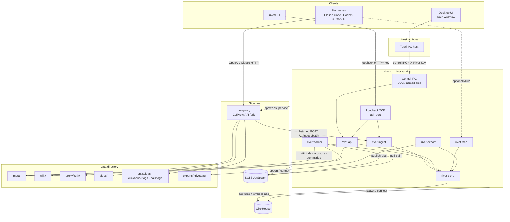

### Process boundaries

| Process | Owns |
| --- | --- |
| Desktop app | Tray, UI; starts/stops `rivetd` via Tauri; injects control key over IPC |
| `rivetd` | API, ingest, workers, MCP, control IPC; supervises sidecars |
| `rivet-proxy` | Provider routing, OAuth login, quota management API, `rivetsink` push |
| NATS JetStream | Durable job plane (`RIVET_JOBS` / `RIVET_JOBS_DEAD`) |
| ClickHouse | Durable `capture_events` + `embeddings` (analytics only — not jobs) |

Workers run as Tokio tasks inside `rivetd` (desktop default `RIVET_WORKER_ROLE=all`
spawns three isolated role loops). They are not a separate binary locally.

---

## Ports, URLs, and auth

Defaults from `RivetConfig` (`crates/rivet-core/src/config.rs`):

| Surface | Default | Auth / binding |
| --- | --- | --- |
| Proxy (harnesses) | `http://127.0.0.1:18317` | Loopback. Harness client keys optional (`access.api-keys: []` by default). Management uses distinct `management_secret`. Busy-port fallbacks: `18741`, `28417`, `38417`, `48417`, `5817` |
| API + ingest (TCP) | `http://127.0.0.1:8741` | Loopback `Host`. Control: `X-Rivet-Key` / `Authorization: Bearer` = `proxy_access_key`. Ingest: `X-Rivet-Ingest-Key` **or** `X-Rivet-Key`. Rate-limited (`tower-governor`, default 500 rps / 1000 burst) |
| MCP | `http://127.0.0.1:8742/mcp` | Loopback `Host`; if `Origin` present must be allowlisted. **No API key** |
| ClickHouse HTTP | `http://127.0.0.1:8123` | Local sidecar (empty password) or `RIVET_CLICKHOUSE_URL` |
| NATS client | `nats://127.0.0.1:4222` | Local sidecar or `RIVET_NATS_URL`; monitoring HTTP on `nats_port + 1000` (`5222`) |
| Control IPC | `{data}/rivetd.sock` (Windows named pipe) | HTTP/1.1 over UDS/pipe; host injects `X-Rivet-Key`. **API only — no ingest**. Webview never sees the raw key |
| Metrics | `GET /metrics` on API TCP | Loopback; default `metrics_enabled: true` |

**Public (loopback Host, no key):** `/v1/status`, `/v1/session`, `/v1/openapi.json`, `/v1/live`.

`proxy_access_key` and `management_secret` are generated as `rivet_{uuid}`; on load,
`management_secret` is forced distinct from the access key.

### Env overrides

| Var | Role |
| --- | --- |
| `RIVET_DATA_DIR` | Data root |
| `RIVET_PROXY_BIN` / `RIVET_CLICKHOUSE_BIN` / `RIVET_NATS_BIN` | Sidecar binaries |
| `RIVET_CLICKHOUSE_URL` / `RIVET_NATS_URL` | External CH / NATS (skip bundled spawn) |
| `RIVET_INGEST_URL` / `RIVET_INGEST_KEY` | Set by runtime when spawning the proxy |
| `RIVET_BLOBS_DIR` / `RIVET_INGEST_SPOOL_DIR` | Passed into proxy child |
| `RIVET_WORKER_ROLE` | `all` (default) / `embed` / `compact` / `wiki` |
| `RIVET_OTLP_ENDPOINT` | Optional OTLP tracing |
| `RIVET_STARTUP_INJECT` | `0` disables SessionStart memory inject |
| `RIVETD_BIN` / `RIVET_API_URL` | Desktop/CLI resolve paths |
| `RIVET_PLUGINS_SRC` | Plugin source tree for harness install |

---

## Boot and sidecar lifecycle

Actual start order in `rivet-runtime` (`Runtime::run_inner`):

1. Telemetry → discover/ensure data dirs → acquire `pids/rivetd.lock`
2. Load `config.json` (migrate busy `proxy_port` if needed)
3. **Proxy `start()`** — failure is **warn-only** (UI can start it later)
4. **NATS** — fatal without binary **and** without `RIVET_NATS_URL`; ensure JetStream schema
5. **ClickHouse** — same pattern with `RIVET_CLICKHOUSE_URL`; `ensure_schema`
6. Spawn worker role loops; start proxy **watchdog** (5s, only while desired-running)
7. Bind TCP `127.0.0.1:{api_port}` with **API ∪ ingest** (+ rate limit / metrics)
8. Serve control IPC (**API-only**) and MCP on `{mcp_port}`
9. Shutdown on SIGTERM/SIGINT, `/v1/shutdown`, or serve error → stop proxy, CH, NATS

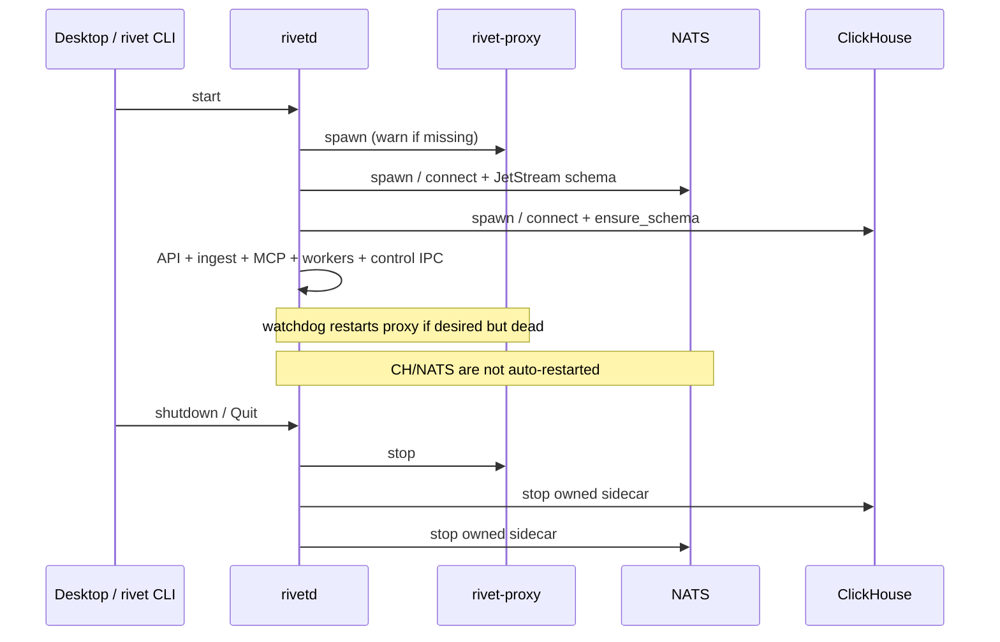

| Component | Supervised | External alt | Auto-restart |
| --- | --- | --- | --- |
| `rivet-proxy` | Yes | Local binary required | Yes (5s watchdog) |
| ClickHouse | Yes if binary found | `RIVET_CLICKHOUSE_URL` | No |
| NATS | Yes if binary found | `RIVET_NATS_URL` | No |

Desktop Quit: `POST /v1/shutdown` + `POST /v1/proxy/stop` over IPC, then TERM/KILL held
`rivetd` child and reclaim proxy/CH/rivetd pidfiles.

---

## Data flows

### 1. Model request path (harness → provider)

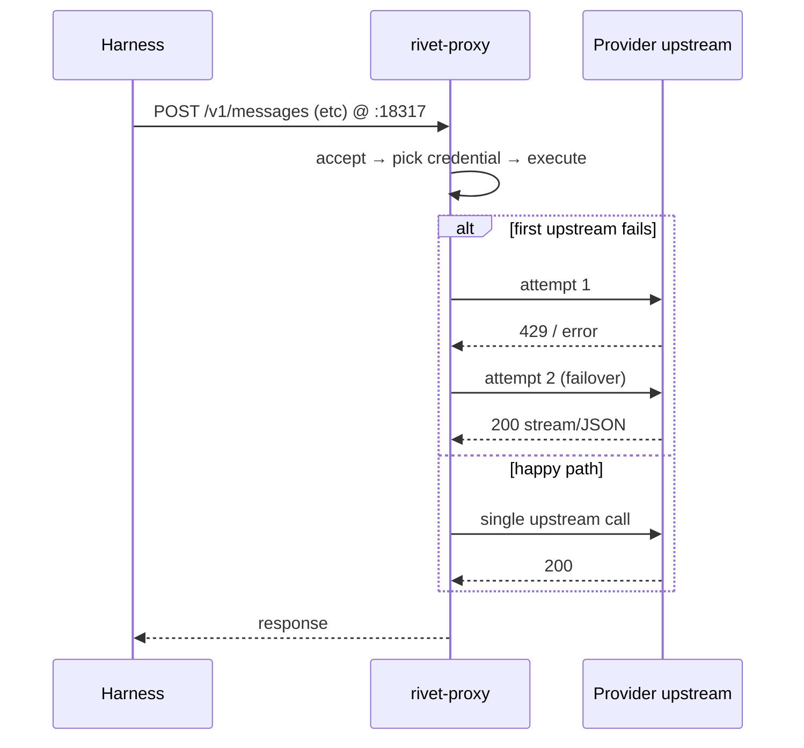

The harness never calls providers directly. Each failover retry is an extra
`proxy → upstream` hop. Winning `upstream_host` + `attempt_count` land on the
captured event.

### 2. Capture ingest (proxy → ClickHouse)

Not disk log scraping. The Rivet fork wraps CPA’s request logger (`rivetsink`)
and **pushes** events over HTTP.

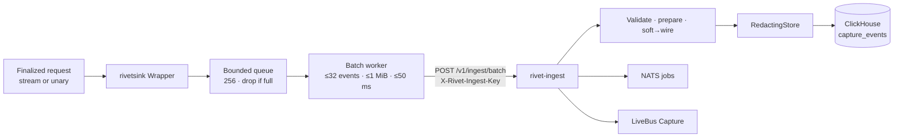

| Detail | Behavior |
| --- | --- |
| Trigger | Same logger hook CPA uses for request logs |
| Payload | Structured `CaptureEvent` (no credentials) |
| Server limits | Batch ≤2000 events; content ≤2 MiB; token fields capped |
| Disk `request-log` | **Off by default** — ClickHouse is the product store |
| Overflow | After 3 retries, spool under `{data}/spool/ingest` |
| Preview / spill | CH `content` holds a truncated preview; full body may spill to `blobs/capture/…` with `body_ref` |
| Skipped | Requests marked `x-rivet-internal` |

### 3. Desktop control path (UI → rivetd)

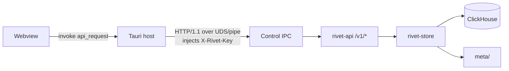

Loopback TCP on `api_port` still serves the same control routes for CLI, plus
ingest for the proxy. The webview never uses TCP to `rivetd` and never sees the
raw access key. Desktop also polls `GET /v1/live` over IPC every 2s and emits
`rivet-live`.

### 4. Conversations / Data pane

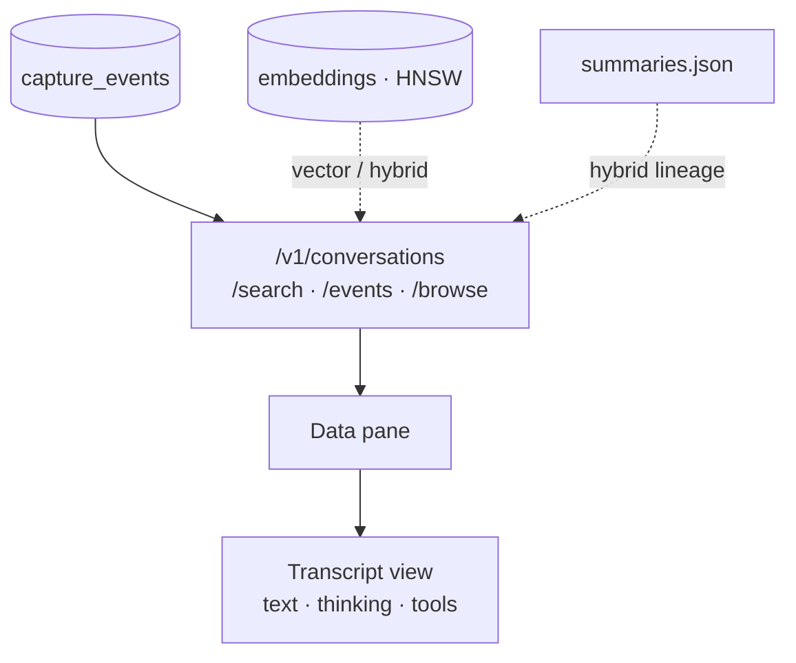

Events sharing a `session_id` become one conversation. Keyword search hits
ClickHouse content; vector search uses the ClickHouse HNSW `embeddings` index
then hydrates capture rows. Conversation search accepts
`mode=keyword|vector|semantic|hybrid|rrf` (RRF + recency/access boosts +
summary lineage expand in API/`fusion.rs`/`scoring.rs`).

### 5. Quota

Management calls use `management_secret` (not the harness access key). History
samples live in meta JSONL, not ClickHouse.

### 6. Accounts / OAuth

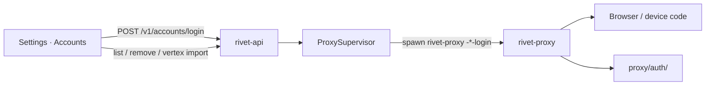

### 7. Harness install

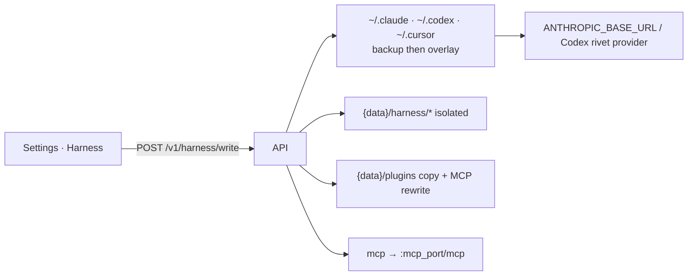

Targets: `claude` | `codex` | `cursor`. Modes: `user` (default) | `isolated`.
Install always copies bundled `plugins/` into `{data}/plugins` and rewrites MCP
URLs to the configured `mcp_url()`.

### 8. Workers: NATS JetStream job plane + role isolation

Jobs live in NATS JetStream (`RIVET_JOBS` WorkQueue + `RIVET_JOBS_DEAD` for
flagged/dead). Publish uses `Nats-Msg-Id = job_key` for dedup; role pull
consumers claim with ack/nak (retry). ClickHouse stays analytics-only.

Ingest enqueues live `embed-event` / optional `synthesize-tool` /
`classify-session`. A 60s backstop publishes `enqueue-unembedded`,
`enqueue-idle`, `upsert-topics`, and (when wiki capability is on)
`extract-wiki:tick` / `enqueue-wiki-backfill:tick`.

| Role (`RIVET_WORKER_ROLE`) | Claims |
| --- | --- |
| `embed` | `embed-event`, `enqueue-unembedded` |
| `compact` | `classify-session`, `compact-session`, `enqueue-idle`, `synthesize-tool`, `suggest-tags` |
| `wiki` | `upsert-topics`, `extract-wiki`, `enqueue-wiki-backfill`, `consolidate-wiki`, `recompile-wiki` |
| `all` (desktop default) | Every role as **three** isolated Tokio loops in one process |
| `none` | No NATS consumers (API-only rivetd when workers are split out) |

Priorities: live compact `0`, embed `3`, classify `4`, wiki `5`, backfill `10`.

```mermaid
flowchart TB
  Ingest[HTTP ingest] -->|publish| NATS[(JetStream RIVET_JOBS)]
  Backstop[60s backstop] -->|publish| NATS
  NATS --> EmbedLoop[embed pull consumer]
  NATS --> CompactLoop[compact pull consumer]
  NATS --> WikiLoop[wiki pull consumer]
  EmbedLoop --> Emb[(embeddings HNSW · lexical 64-d)]
  CompactLoop --> MetaS[session_projects / summaries]
  WikiLoop --> MetaT[topics.json]
  WikiLoop --> WikiFS[wiki/&#123;project&#125;/*.md]
  WikiLoop -.->|flagged| Dead[(RIVET_JOBS_DEAD)]
  FS[FS watcher] --> MetaW[wiki_pages.json]
```

| Job plane detail | Value |
| --- | --- |
| Jobs stream | `RIVET_JOBS` — WorkQueue, subjects `rivet.jobs.>`, file store, duplicate_window 120s |
| Dead stream | `RIVET_JOBS_DEAD` — subject `rivet.dead.jobs` (outside WorkQueue wildcard) |
| Subject | `rivet.jobs.<task>` |
| Consumers | durable `rivet-embed` / `rivet-compact` / `rivet-wiki`; ack_wait 90s; max_deliver 8 |
| Success / retry | `ack`; else attempts++ → Nak delay or publish dead then ack |
| Coalesce | sibling `extract-wiki` jobs with overlapping `session:` / `topic:` routes can fold into one LLM call |

API: `GET /v1/workers/queue`, `POST /v1/workers/tick`, `GET|POST /v1/workers/flagged`,
queue counters on `/v1/status`.

#### Compaction DAG

`compact-session` builds a leaf → branch → root summary DAG
(`COMPACT_PIPELINE_VERSION` in meta):

1. **Leaves** — batches of ~10 events (`summary:{sid}:leaf:{i}`)
2. **Branches** — groups of leaves (`…:branch:{i}`), leave `parent_id` links
3. **Root** — session root + title; branches get `parent_id`

Idle enqueue reasons: `threshold` (≥10 unsummarized), `idle` (15m quiet),
`stale` (~4d or new captures since root), `pipeline` (version bump). Leaf/branch/root
bodies run a `work_first` strip so meta openings are dropped. After compact:
`upsert-topics`, `suggest-tags`, and `extract-wiki:{summary_id}`.

#### Wiki / topics knowledge pipeline

1. Compact enqueues `extract-wiki:{id}` with routes (`session:…`, `topic:…`)
2. Extract coalesces sibling jobs → schemars-constrained `PagePatch`es → merge →
   bound (16 KiB article / 4 KiB section / 12 KiB sections / 2400-char summary)
3. Overflow → monthly `archive/<slug>/YYYY-MM[.N].md`
4. Identity/stem `consolidate-wiki`; merge-prompt `recompile-wiki` (≥~60 KiB)
5. Knowledge pages use `<!-- rivet:knowledge -->` so capture upserts do not clobber them;
   `archive/` is not indexed. Entity pages live under `entities/` (optionally
   `entities/{type}/`). Topics nest ≤4 levels (`parent_slug`)
6. FS watcher keeps `wiki_pages.json` in sync and bumps wiki revision / LiveBus

#### Embed path

`embed-event` writes **lexical** 64-d vectors into ClickHouse `embeddings`
(`LEXICAL_SPACE`) with HNSW cosine index.

### 9. MCP

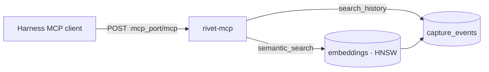

Single v1 surface: streamable HTTP via `rmcp` at `/mcp`.

| Tool | Purpose |
| --- | --- |
| `search_history` | Keyword search over captures |
| `semantic_search` | Lexical vector search (gated by `capabilities.vector_search`); keyword fallback |
| `topic_search` | Search durable knowledge topics |
| `topic_get` | Fetch one topic by slug or id |
| `get_full` | Hydrate a capture event or conversation with full bodies |
| `browse_session` | Browse normalized turns for a session |
| `memory_stats` | Summary stats for memory / topics / wiki |

Hybrid conversation search and memory startup are **control API** surfaces
(`/v1/conversations/search?mode=hybrid`, `/v1/memory/startup`) — not MCP tools.

### 10. Export / import

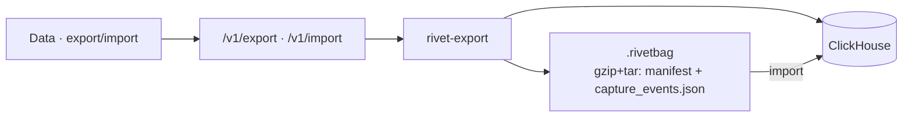

Embeddings and wiki are not packaged (`includes_embeddings=false`,
`includes_wiki=false`). Credentials are never included. Export hydrates
`body_ref` into `content` when blobs are available and re-redacts.
`POST /v1/export` accepts an optional body
`{ "conversation_ids": ["…"] }` to package one conversation or the current
search hit set; omit the body (or ids) for a full traffic dump.

Offline transcript import: `POST /v1/ingest/local` (Claude / Codex / Cursor
trees) with `capture_quality=imported`.

### 11. Live refresh

| Route | Role |
| --- | --- |
| `GET /v1/live` | Snapshot cursor (`wiki_revision`, `capture_events`, `observed_at`) — public |
| `GET /v1/events` | SSE: seed `cursor`, then `live` (`wiki` / `capture` / `heartbeat`) — API key |

Ingest publishes `LiveEvent::Capture` after successful insert. Desktop host polls
`/v1/live` and emits `rivet-live` to the webview.

### 12. Logs (debug escape hatch)

```mermaid
flowchart LR
  UI[Runtime pane] --> API["/v1/logs/&#123;proxy|clickhouse&#125;"]
  API --> Files[Newest *.log under<br/>proxy/logs or clickhouse/logs]
```

---

## Control API surface

Grouped from `crates/rivet-api` (OpenAPI export is partial — see
`scripts/export-openapi.sh` → `docs/openapi.json`).

| Group | Routes |
| --- | --- |
| Bootstrap | `GET /v1/status`, `/v1/session`, `/v1/openapi.json`, `/v1/live` |
| Live | `GET /v1/events` (SSE) |
| Config / control | `GET\|PUT /v1/config`, `POST /v1/proxy/start\|stop`, `POST /v1/shutdown`, `GET /v1/logs/{kind}` |
| Captures | `/v1/captures/recent`, `/search`, `/full`, `/v1/demo/seed` |
| Conversations | `/v1/conversations`, `/search`, `/events`, `/browse` |
| Accounts / quota | `/v1/providers`, `/v1/accounts*`, `/v1/quota*` |
| Wiki / topics / memory | `/v1/wiki*`, `/v1/topics*`, `/v1/summaries`, `/v1/memory/startup`, `/v1/memory/stats` |
| Harness | `/v1/harness/write`, snippets, `/v1/harness/session` |
| Workers | `/v1/workers/tick`, `/queue`, `/flagged` |
| Export | `/v1/export`, `/v1/import`, `/v1/ingest/local` |
| Ingest (same TCP port) | `POST /v1/ingest`, `POST /v1/ingest/batch` |

---

## Storage model

### ClickHouse

Primary local store. Schema applied at boot (`CREATE DATABASE rivet` + versioned
migrations in `schema_migrations`). Details: [clickhouse.md](clickhouse.md).

| Table / artifact | Role |
| --- | --- |
| `capture_events` | One row per captured request/stream segment (MergeTree, `ORDER BY (ts, id)`) |
| `embeddings` | Lexical 64-d vectors; ReplacingMergeTree + HNSW `vector_similarity('hnsw', 'cosineDistance', 64)` |
| `schema_migrations` | Applied migration versions |

Job durability is **not** in ClickHouse. Wiki **index** and quota history samples
live in meta files.

### NATS JetStream (job plane)

Bundled `nats-server` (desktop/CLI) or external `RIVET_NATS_URL`. File-backed
store under `{data}/nats/`.

| Stream / artifact | Role |
| --- | --- |
| `RIVET_JOBS` | WorkQueue subjects `rivet.jobs.<task>`; `Msg-Id=job_key` publish dedup |
| Role pull consumers | `embed` / `compact` / `wiki` filter by task; ack = done, nak = retry |
| `RIVET_JOBS_DEAD` | Flagged / exhausted jobs on `rivet.dead.jobs` |

Ingest rejects oversized batches / content before insert (`rivet-core`
`ingest_validate`).

### Capture vs classification

**Live capture is proxy-only.** Harnesses route through `rivet-proxy`;
`rivetsink` POSTs batches to `/v1/ingest`. Harness plugins never ingress
captures, tools, or thinking.

**Subagent context** is detected on the wire from request headers (no plugin
needed): Claude Code `x-claude-code-agent-id` / `parent-agent-id` /
`request-class` / `agent-type`, plus OpenCode `x-parent-session-id`. Fields
land on `capture_events` and surface in the Data pane.

**Other proxy-only enrichments** (still no harness ingress): cache-read /
cache-creation / thinking token breakdowns; `git_branch` / `git_repo` from
`git_state`; `task_id` / `turn_id`; winning `upstream_host` + `attempt_count`;
`stop_reason`; wire-parsed `tool_names` + `tool_call_count`; `stream_complete`;
`request_path` / `api_format`; `error_type` / `error_message`; credential
`auth_id`; `has_thinking`; `media_count`.

**Capture quality:** `wire` (hard session marker), `soft` (`soft:{hash}` from
provider+account+model+prompt fingerprint), `imported` (local transcript
import). Soft→wire upgrades record aliases in `meta/soft_wire.json` (and
ingest-only `soft_alias` is not persisted to CH).

`project_id` is set only with **hard evidence**:

- explicit headers (`x-project-id`, `x-rivet-project-id`, `project-id`,
  `openai-project`, …) or body `project_id` / `metadata.project_id`
- harness on-disk project key on import (Claude `~/.claude/projects/<id>/`,
  Cursor `~/.cursor/projects/<slug>/`)
- optional Rivet harness plugin binding (`POST /v1/harness/session`) joined at
  ingest before ClickHouse insert

Cwd alone is stored as `cwd`, never promoted to `project_id` at capture.
**Classification** (`classify-session` worker) fills gaps when hard evidence was
absent — assign from cwd + content + session affinity.

**Harness plugins** (optional — `plugins/rivet`, `plugins/rivet-codex`,
`plugins/rivet-cursor`, shared `plugins/common`): SessionStart / cwd heartbeats,
SessionEnd clear, Rivet MCP, SessionStart inject of budgeted
`/v1/memory/startup` (workspace `SOUL.md` / `IDENTITY.md` / `MEMORY.md` /
`AGENTS.md` + recall), and (Claude) a forward-compatible `customHeadersHelper`
for `X-Project-Id`. Proxy routing alone is enough to capture; plugins never
ingress captures. Disable inject with `RIVET_STARTUP_INJECT=0`.

### Meta files (`{data}/meta/`)

| File | Role |
| --- | --- |
| `jobs.json` | Worker cursors (vectorize / wiki / topics / classify / compact, …) |
| `wiki_pages.json` | Wiki page index for the UI |
| `topics.json` | Durable topics with citations (curated fields preserved) |
| `summaries.json` | Compaction summary DAG per session |
| `enrichments.jsonl` | Worker enrichments (e.g. tool-synth), not harness ingress |
| `session_projects.json` | Session → project/cwd bindings |
| `quota_snapshots.jsonl` | Quota history samples |
| `tidy_proposals.json` | Human-gated topic tidy proposals |
| `tag_suggestions.json` | Pending tag suggestions |
| `access_counts.json` | Hybrid search access boosts |
| `soft_wire.json` | Soft → hard session map |

### Other directories

| Path | Role |
| --- | --- |
| `config.json` | Rivet config (ports, keys, capabilities, models) |
| `proxy/auth/` | OAuth / provider credentials (never exported) |
| `proxy/logs/` | Process + forced error logs |
| `clickhouse/` | Sidecar data / logs / `config.xml` |
| `nats/` | JetStream store / logs / `nats.conf` |
| `wiki/` | Generated markdown tree |
| `exports/` | `.rivetbag` packages |
| `blobs/` | Spilled full bodies when preview is truncated (`body_ref`) |
| `harness/{claude,codex}/` | Isolated harness configs |
| `plugins/` | Local marketplace copy installed for harnesses |
| `spool/ingest/` | rivetsink overflow spool |
| `pids/` | Sidecar + rivetd PID / lock files |
| `rivetd.sock` | Control IPC (Unix) |

Default data root: macOS `~/Library/Application Support/Rivet`, Linux
`~/.local/share/Rivet`, Windows `%APPDATA%\Rivet` (`RIVET_DATA_DIR` overrides).

---

## Local vs enterprise

| Concern | Local (desktop / CLI) | Enterprise (Helm `charts/rivet`) |
| --- | --- | --- |
| Proxy | Sidecar process (`:18317`) | Deployment (chart often `:8317`) |
| ClickHouse | Bundled single-node or URL | Altinity CHI / managed (analytics only) |
| NATS | Bundled `nats-server` JetStream (**required**) | Official `nats` subchart (JetStream) or `nats.url` |
| Workers | In-process role loops (`RIVET_WORKER_ROLE=all`) | Same in-process on rivetd (role-split Deployments not ready — meta is process-local) |
| Bus | NATS JetStream job plane + in-process `LiveBus` | Same intended JetStream URL; Redpanda optional later for fan-out |
| UI auth | Loopback + key / control IPC | OIDC + admin portal (scaffold) |
| Tenancy | Single user | Org / team namespaces (`capabilities.teams`) |

Shared contracts: ingest protocol, store schemas, MCP tools, `.rivetbag` format.
See [enterprise.md](enterprise.md) for Helm install notes.

---

## Desktop UX map

| Pane | Reads | Writes |
| --- | --- | --- |
| Quota | `/v1/quota`, history, capture burn | Refresh credentials |
| Data | Conversations / search / events / browse | Export · import |
| Topics | `/v1/topics*` + wiki knowledge/archive | tidy / tags / flagged |
| Runtime | Status, sidecar health, log tails, worker cards | Start/stop proxy; run workers |
| Wiki | `/v1/wiki` + pages + archives | (generated by worker) |
| Settings | Accounts, intelligence, harness | Login, import, harness write, models/caps |

Close-to-tray; Quit from tray stops `rivetd`.

---

## Security / ToS posture

- Capture is local by default.
- Export is user-initiated capture sharing, not credential sharing.
- Multi-account pooling carries provider ToS risk (disclose in product).
- Redaction covers common secrets (Bearer, `sk-*`, JWTs, PEM, OAuth JSON fields,
  `rivet_*` keys, Slack/PEM/ASIA patterns, …) on write and before spill.
- Proxy logrus: Rivet `RedactHook` masks tokens before stdout/file sinks.

## Stack locks

- Rust for Rivet backend crates
- Go only inside the forked proxy sidecar
- Tauri 2 desktop → DMG / deb+AppImage / NSIS
- ClickHouse for capture analytics + embeddings (not jobs; official `clickhouse` Rust client)
- NATS JetStream for the durable job plane (desktop ≡ intended prod path)
- MCP via official `rmcp` streamable HTTP; control contracts via `utoipa`
  (`GET /v1/openapi.json`); desktop Effect schemas mirror exported OpenAPI
  (`scripts/export-openapi.sh` → `docs/openapi.json`)
- Live refresh: `LiveBus` → `GET /v1/live` + `GET /v1/events` (SSE); Tauri emits `rivet-live`
- Loopback API/ingest: `tower-governor` rate limits + optional Prometheus (`GET /metrics`)
- Optional OTLP tracing when `RIVET_OTLP_ENDPOINT` is set
- No TigerBeetle; no Flink locally (Rust workers; Redpanda optional later for enterprise fan-out)

## Implementation notes

1. **Ingest** is HTTP batch to `/v1/ingest/batch` (async queue in `rivetsink`).
   Batches are size-validated before insert.
2. **Embeddings** live in ClickHouse with HNSW; embed path is **lexical-only**.
   Wiki index and quota history remain meta-file backed. Schema evolves via
   versioned CH migrations.
3. **`body_ref` / `blobs/`** hold spilled full turns when the preview is short; small
   bodies stay in `content`.
4. **Project** on capture is hard-evidence only; workers classify from `cwd` + context
   when needed.
5. Helm proxy port may differ from the local default `18317`. Role-split worker
   Deployments are blocked until meta has cross-process locking and workers can
   reach an authenticated proxy URL for LLM jobs.
6. **Jobs** are NATS JetStream messages (`Msg-Id=job_key` dedup, role pull consumers,
   dead stream for flagged) — not Postgres/SQLite/ClickHouse.
7. **Control IPC ≠ full TCP surface** — no ingest merge, no governor/metrics layers.
8. Proxy boot failure is non-fatal; NATS and ClickHouse without URL are fatal.
