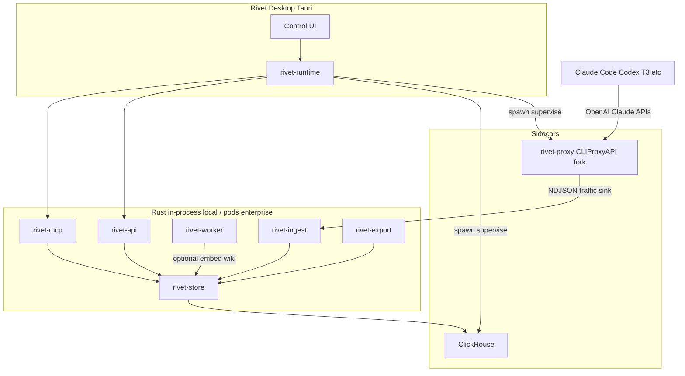

# Rivet architecture

## Goals

1. **Local by default** — one DMG, open app, accounts work, harnesses point at `localhost`.
2. **Enterprise-shaped components** — same crates become services behind Helm later.
3. **Fast Rust control plane** — ingest, store, workers, MCP, API in Rust.
4. **Proven proxy** — fork/embed CLIProxyAPI (Go) as a sidecar; do not rewrite providers day one.

## What “tokens” means

**Traffic data:** prompts, completions, tool calls, usage counts, model IDs, latency, cache hits, project/session IDs.

**Not exportable:** OAuth blobs, API keys, management secrets, provider credentials.

## Component map

## Local vs enterprise

| Concern | Local (DMG) | Enterprise (Helm) |
| --- | --- | --- |
| Proxy | Sidecar process | Deployment |
| ClickHouse | Bundled single-node | Cluster / managed CH |
| Workers | Tokio tasks in-process | Job pods / queue consumers |
| Bus | Polling workers (local) | NATS or Redpanda |
| Auth for UI | Loopback Host + `X-Rivet-Key` | OIDC + admin portal |
| Tenancy | Single user | Org / team namespaces |

Interfaces stay the same: ingest protocol, store schemas, MCP tools, export package format.

## Proxy strategy

Fork CLIProxyAPI into `vendor/cliproxyapi` (binary name `rivet-proxy`).

Add a **Rivet sink**: on each finalized request/response (including streams), append a structured event to a Unix socket or `http://127.0.0.1:<rivet>/v1/ingest` that `rivet-ingest` owns.

Keep upstream login flows (`-claude-login`, `-codex-device-login`, etc.). Desktop UI wraps them.

Routing features Theo cares about (session affinity, soonest-reset-first) live in the fork over time.

## Data plane

**SQLite** (via `rivet-store`) — primary local traffic store, app config, wiki page index, job cursors.

**ClickHouse** (optional sidecar) — dual-write analytics when the binary is present; UI reads still prefer SQLite.

**Object/blob dir** — large bodies / export packages under `~/Library/Application Support/Rivet/` (macOS).

### Core tables (ClickHouse)

- `traffic_events` — one row per request or stream segment (ts, account_id, provider, model, session_id, project_id, role, tokens_in/out, latency_ms, body_ref)
- `usage_rollups` — materialized views by account/model/day
- `embeddings` — optional; vector column or external index pointer
- `wiki_pages` — optional generated docs (or live in SQLite + markdown files)

## Workers

Local: `rivet-worker` Tokio tasks polled on a timer (vectorize + wiki); not a push bus yet.

Enterprise: same crate, pull from NATS/Redpanda.

Jobs:

1. Normalize / redact traffic into searchable documents
2. Embed (if embedding model configured)
3. Wiki upsert per project (if text-gen model configured)

MCP works without 2–3 (SQL + full-text). Quality jumps with vectors + wiki.

## Export / import

Package format: `.rivetbag` (tar + gzip)

Contains: `manifest.json` + `traffic_events.json` (embeddings/wiki optional later).

Excludes: OAuth credential directories, proxy access keys, management secrets. Captured content may still hold sensitive text after best-effort redaction.

## Desktop UX (Docker Desktop–like)

- Tray + main window
- Proxy running / stopped
- Accounts + limits + reset timers
- Token/usage charts
- Open wiki
- MCP endpoint + copy config for harnesses
- Export / import
- Point harness: one-click write Claude/Codex base URL to Rivet proxy

## Security / ToS posture

- Capture is local by default
- Export is user-initiated traffic sharing, not credential sharing
- Multi-account pooling carries provider ToS risk (disclose in product); Rivet does not encourage reselling sub traffic as public API

## Stack locks

- Rust for Rivet backend crates
- Go only inside forked proxy sidecar
- Tauri 2 desktop → DMG
- ClickHouse for analytics events
- No TigerBeetle (wrong problem domain)
- No Flink locally; Rust workers (+ Redpanda later for enterprise fan-out)
