# Rivet architecture

Rivet is a local-first multi-account AI proxy: harnesses talk to a localhost
proxy, Rivet captures traffic into ClickHouse, and the desktop app surfaces
quota, conversation history, wiki, and MCP.

## Goals

1. **Local by default** — one desktop installer; accounts and harnesses work on `localhost`.
2. **Enterprise-shaped components** — same crates can become Helm services later.
3. **Fast Rust control plane** — ingest, store, workers, MCP, and API in Rust.
4. **Proven proxy** — fork/embed CLIProxyAPI (Go) as `rivet-proxy`; do not rewrite providers day one.

## What is (and isn’t) traffic

**Captured / exportable traffic:** prompts, completions, tool calls, usage counts,
model IDs, latency, session IDs, cwd signals, account labels, and `project_id`
only when hard evidence exists (explicit field/header or harness `projects/<id>/`
key — never guessed from cwd alone).

**Never exported as credentials:** OAuth blobs, API keys, management secrets,
provider credentials under `proxy/auth/`. Captured text may still be sensitive
after best-effort redaction.

---

## System overview

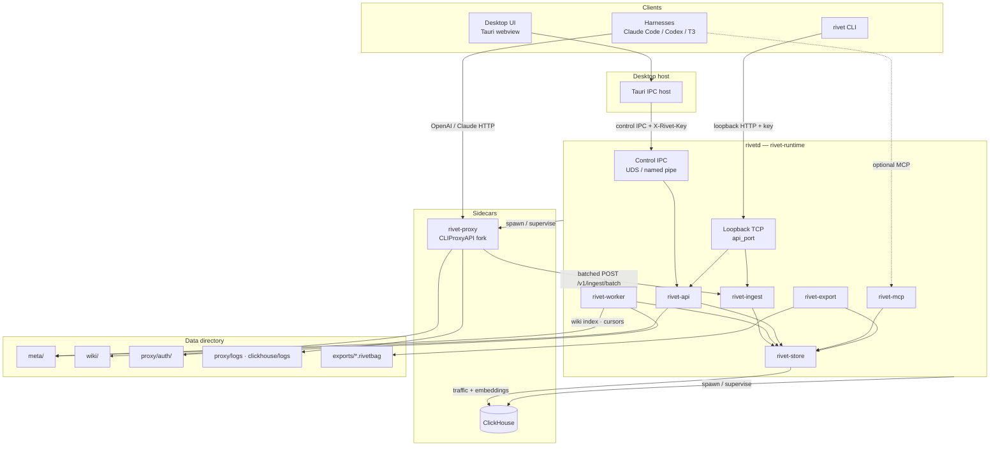

**Process boundaries**

| Process | Owns |
| --- | --- |
| Desktop app | Tray, UI, starts/stops `rivetd` via Tauri |
| `rivetd` | API, ingest, workers, MCP, control IPC; supervises sidecars |
| `rivet-proxy` | Provider routing, OAuth login, quota management API |
| ClickHouse | Durable `traffic_events` |

---

## Ports, URLs, and auth

| Surface | Default | Auth |
| --- | --- | --- |
| Proxy (harnesses) | `http://127.0.0.1:18317` | Harness → proxy access key / provider OAuth as configured |
| API + ingest | `http://127.0.0.1:8741` | Loopback Host + `X-Rivet-Key` / `X-Rivet-Ingest-Key` |
| MCP | `http://127.0.0.1:8742/mcp` | Loopback Host/Origin guards |
| ClickHouse HTTP | `http://127.0.0.1:8123` | Local sidecar / `RIVET_CLICKHOUSE_URL` |
| Control IPC | `{data}/rivetd.sock` (Windows named pipe) | Host injects key; webview never sees it |

Env overrides: `RIVET_DATA_DIR`, `RIVET_CLICKHOUSE_URL`, `RIVET_PROXY_BIN`,
`RIVET_CLICKHOUSE_BIN`. Runtime sets `RIVET_INGEST_URL` / `RIVET_INGEST_KEY` when
spawning the proxy.

---

## Data flows

### 1. Model request path (harness → provider)

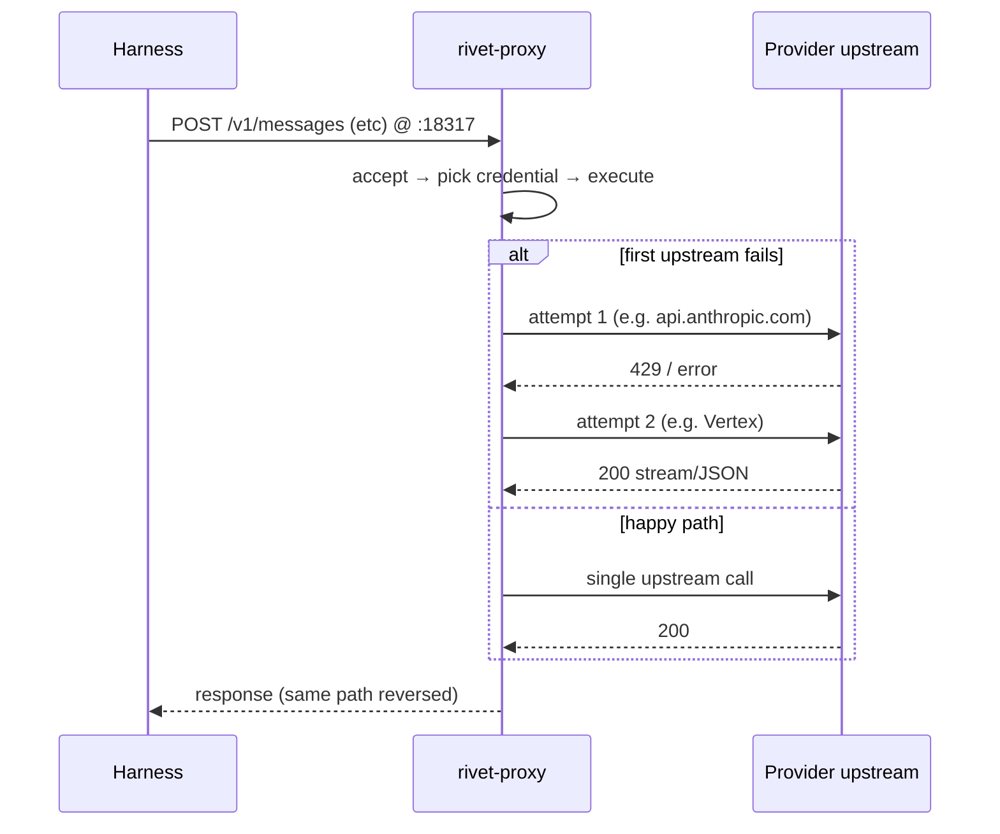

The harness never calls providers directly. Each failover retry is an extra
`proxy → upstream` hop.

### 2. Traffic capture (proxy → ClickHouse)

Not disk log scraping. The Rivet fork wraps CPA’s request logger and **pushes**
events over HTTP.

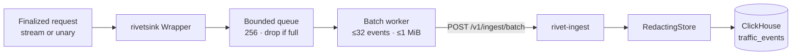

| Detail | Behavior |
| --- | --- |
| Trigger | Same logger hook CPA uses for request logs |
| Payload | Structured `TrafficEvent` (no credentials) |
| Disk `request-log` | **Off by default** — ClickHouse is the product store |
| Forced errors | `error-*.log` still written when the inner logger is disabled |
| Process logs | Under `logs-max-total-size-mb: 256` cleaner |

### 3. Desktop control path (UI → rivetd)

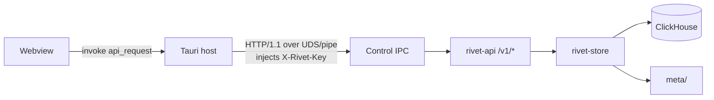

Loopback TCP on `api_port` still serves the same control routes for CLI, plus
ingest for the proxy. The webview never uses TCP to `rivetd` and never sees the
raw access key.

### 4. Conversations / Data pane

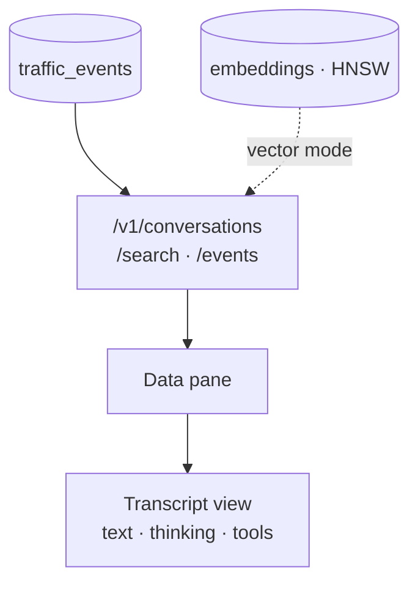

Events sharing a `session_id` become one conversation. Keyword search hits
ClickHouse content; vector search uses the ClickHouse HNSW `embeddings` index
then hydrates traffic rows.

### 5. Quota

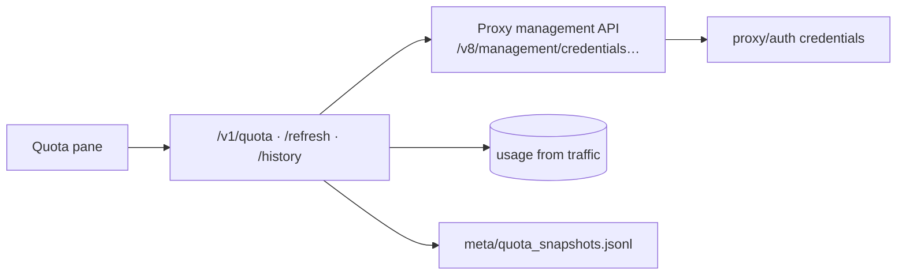

Management calls use `management_secret` (not the harness access key). History
samples live in meta JSONL, not ClickHouse.

### 6. Accounts / OAuth

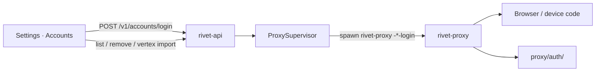

### 7. Harness install

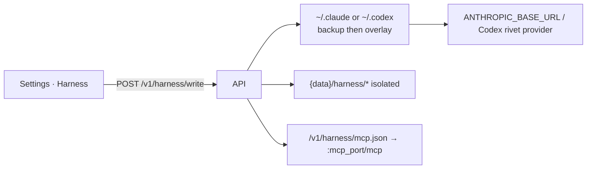

### 8. Workers: NATS JetStream job plane + role isolation

Jobs live in NATS JetStream (`RIVET_JOBS` WorkQueue + `RIVET_JOBS_DEAD`
for flagged/dead). Publish uses `Nats-Msg-Id = job_key` for dedup; role
pull consumers claim with ack/nak (retry) — no Postgres/SQLite/ClickHouse
queue. ClickHouse stays analytics-only (traffic + embeddings).

Ingest enqueues live `embed-event` / `classify-session`; cron backstops
enqueue backlog scans, idle compact, topics, and wiki extract.

| Role (`RIVET_WORKER_ROLE`) | Claims |
| --- | --- |
| `embed` | `embed-event`, `enqueue-unembedded` |
| `compact` | `classify-session`, `compact-session`, `enqueue-idle`, … |
| `wiki` | `upsert-topics`, `extract-wiki`, `enqueue-wiki-backfill`, `consolidate-wiki`, `recompile-wiki`, … |
| `all` (desktop default) | Every role as isolated Tokio loops in one process |

```mermaid
flowchart TB
  Ingest[HTTP ingest] -->|publish| NATS[(JetStream RIVET_JOBS)]
  Backstop[60s backstop] -->|publish| NATS
  NATS --> EmbedLoop[embed pull consumer]
  NATS --> CompactLoop[compact pull consumer]
  NATS --> WikiLoop[wiki pull consumer]
  EmbedLoop --> Emb[(embeddings HNSW)]
  CompactLoop --> MetaS[session_projects / summaries]
  WikiLoop --> MetaT[topics.json]
  WikiLoop --> WikiFS[wiki/&#123;project&#125;/*.md]
  WikiLoop -.->|flagged| Dead[(RIVET_JOBS_DEAD)]
  FS[FS watcher] --> MetaW[wiki_pages.json]
```

API: `GET /v1/workers/queue`, `POST /v1/workers/tick`, queue counters on
`/v1/status`. Helm can run three Deployments of the same binary with
`RIVET_WORKER_ROLE=embed|compact|wiki` against a shared NATS URL
(`RIVET_NATS_URL`); desktop bundles `nats-server` as a sidecar.

MCP tools: `search_history`, `semantic_search`, `hybrid_search` (RRF +
recency/access boosts + summary lineage expand), `topic_search`, `topic_get`,
`get_full`, `browse_session`, `memory_stats`, `memory_startup`. Conversation
search accepts `mode=hybrid`. Compaction writes a leaf→branch→root summary DAG
with incremental tails: active threshold (≥10 unsummarized), idle mop (15m),
stale refresh (~4d or new traffic since root), and `pipeline_version` bumps to
force re-mine. Summaries stamp `parent_id` / `source_summary_ids`; hybrid API +
MCP expand fused hits through that lineage. Leaf/branch/root bodies run a
`work_first` strip so meta openings ("This batch…") are dropped. Wiki knowledge pipeline (RivetHub-aligned, file-backed): compact enqueues
per-summary `extract-wiki:{id}`; extract is page-aware (existing topic
inventories), coalesces same-session and same-topic-route summaries, emits
ClickHouse claim/gather coalesce (sibling `extract-wiki` jobs sharing
`session:` / `topic:` routes are claimed, folded into one LLM call, then
completed or released) → schemars-constrained `create`/`update` `PagePatch`es
(`response_format` + prompt schema; soft fallback) with citations/sources →
merge →
bound (16 KiB article / 4 KiB section / 12 KiB sections / 2400-char summary,
fence-aware blocks + repeat drop) → monthly `archive/<slug>/YYYY-MM[.N].md` →
identity/stem `consolidate-wiki` and merge-prompt `recompile-wiki` (≥~60 KiB).
Knowledge pages use `<!-- rivet:knowledge -->` so traffic upserts do not
clobber them; `archive/` is not indexed. Entity pages live under
`entities/` (optionally `entities/{type}/`) with topics under
`type:entities`; extract labels may carry `type:Name`. Apply path can
merge-rewrite existing topic articles before bound. Bound uses
fence-aware rebase/dropped history + entity spill caps. Topics nest ≤4
levels (`parent_slug`). Ingest enqueues `synthesize-tool`.
Desktop Wiki/Topics panes browse monthly archive segments via
`/v1/wiki/archives` + `/v1/wiki/archive`. Topics also show knowledge body
when present. Other APIs: `/v1/topics/tidy`, `/v1/topics/tags`,
`/v1/workers/flagged`. Offline fusion gate:
`crates/rivet-store/tests/search_eval/`. Soft→wire via `soft_alias` /
`soft_wire.json`. Optional SessionStart inject of budgeted
`/v1/memory/startup` (`SOUL`/`IDENTITY`/`MEMORY` + recall) —
`RIVET_STARTUP_INJECT=0` disables. Redaction covers Slack/PEM/ASIA. Proxy
ingest spool under `spool/ingest/`.

### 9. MCP

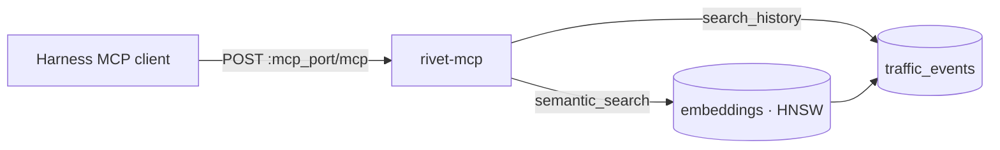

### 10. Export / import

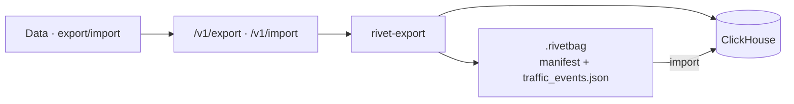

Embeddings and wiki are not packaged yet. Credentials are never included.

### 11. Logs (debug escape hatch)

```mermaid
flowchart LR
  UI[Runtime pane] --> API["/v1/logs/&#123;proxy|clickhouse&#125;"]
  API --> Files[Newest *.log under<br/>proxy/logs or clickhouse/logs]
```

### 12. Sidecar lifecycle

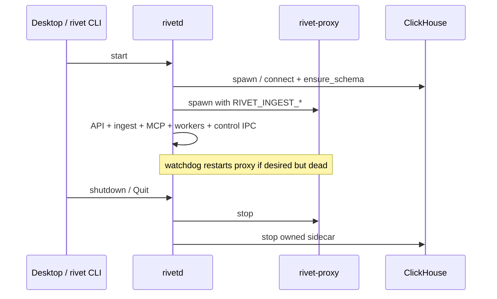

---

## Storage model

### ClickHouse

Primary local store. Schema applied at boot (`CREATE DATABASE rivet` + tables).

| Table / artifact | Role |
| --- | --- |
| `traffic_events` | One row per captured request/stream segment (`session_id`, optional hard-evidence `project_id`, `cwd`, `body_ref`, `capture_quality`, …) |
| `embeddings` | Lexical (64-dim) vectors with HNSW `vector_similarity('hnsw', 'cosineDistance', 64)` |

Job durability is **not** in ClickHouse — see NATS JetStream below.
`usage_rollups` and `wiki_pages` as CH tables remain sketched / optional; the
wiki **index** and quota history samples still live in meta files.

### NATS JetStream (job plane)

Bundled `nats-server` (desktop/CLI) or external `RIVET_NATS_URL` (enterprise).

| Stream / artifact | Role |
| --- | --- |
| `RIVET_JOBS` | WorkQueue subjects `rivet.jobs.<task>`; `Msg-Id=job_key` publish dedup |
| Role pull consumers | `embed` / `compact` / `wiki` filter by task; ack = done, nak = retry |
| `RIVET_JOBS_DEAD` | Flagged / exhausted jobs on `rivet.dead.jobs` (outside WorkQueue wildcard) |

File-backed JetStream store under `{data}/nats/` — same binary path locally and in prod.

Ingest rejects oversized batches / content before insert (`rivet-core`
`ingest_validate`).

### Capture vs classification

**Live capture is proxy-only.** Harnesses route through `rivet-proxy`;
`rivetsink` POSTs batches to `/v1/ingest`. Harness plugins never ingress
traffic, tools, or thinking.

**Subagent context** is detected on the wire from request headers (no plugin
needed): Claude Code `x-claude-code-agent-id` / `parent-agent-id` /
`request-class` / `agent-type`, plus OpenCode `x-parent-session-id`. Fields
land on `traffic_events` and surface in the Data pane (conversation pills +
per-turn badges).

**Other proxy-only enrichments** (still no harness ingress): cache-read /
cache-creation / thinking token breakdowns; `git_branch` / `git_repo` from
`git_state`; `task_id` / `turn_id`; winning `upstream_host` + `attempt_count`
(failover); `stop_reason`; wire-parsed `tool_names` + `tool_call_count`;
`stream_complete`; `request_path` / `api_format`; `error_type` /
`error_message`; credential `auth_id`; `has_thinking`; `media_count`.

**Capture** records observables from the proxy (and optional offline transcript
import via `/v1/ingest/local`): bodies / `body_ref`, sessions (wire or soft),
usage, account labels, cwd when present, and `capture_quality`
(`wire` / `soft` / `imported`).

`project_id` is set only with **hard evidence**:
- an explicit harness/API project field or header on the proxied request,
- the harness’s own on-disk project key (Claude `~/.claude/projects/<id>/`,
  Cursor `~/.cursor/projects/<slug>/` as stored) on import, or
- an optional Rivet harness plugin binding (`POST /v1/harness/session`) that maps
  `session_id` → cwd/project, joined at proxy ingest before ClickHouse insert

Cwd and path text in prompts alone are signals, not project classifications —
unless the plugin attested the session’s project.

**Harness plugins** (optional — `plugins/rivet`, `plugins/rivet-codex`,
`plugins/rivet-cursor`) improve proxy fidelity and session context: SessionStart
/ cwd heartbeats, SessionEnd clear, Rivet MCP, SessionStart inject of budgeted
`/v1/memory/startup` (workspace `SOUL.md` / `IDENTITY.md` / `MEMORY.md` +
recall), and (Claude) a forward-compatible `customHeadersHelper` for
`X-Project-Id` once Claude Code ships that setting. Proxy routing alone is
enough to capture; plugins never ingress traffic.

**Classification** (workers) fills gaps when hard evidence was absent — assign
or reconcile projects from cwd + content + session affinity.

### Meta files (`{data}/meta/`)

| File | Role |
| --- | --- |
| Job cursors | Vectorize / wiki / topics / classify / compact progress |
| `wiki_pages.json` | Wiki page index for the UI |
| `topics.json` | Durable topics with citations (curated fields preserved) |
| `summaries.json` | Compaction summaries per session |
| `enrichments.jsonl` | Worker enrichments (e.g. tool-synth), not harness ingress |
| `session_projects.json` | Session → project/cwd bindings |
| `quota_snapshots.jsonl` | Quota history samples |
| `embeddings.json` | Legacy only — imported into CH once, then `.migrated` |

### Other directories

| Path | Role |
| --- | --- |
| `proxy/auth/` | OAuth / provider credentials (never exported) |
| `proxy/logs/` | Process + forced error logs |
| `wiki/` | Generated markdown tree |
| `exports/` | `.rivetbag` packages |
| `blobs/` | Spilled full bodies when preview is truncated (`body_ref`); small turns stay inline in `content` |
| `pids/` | Sidecar PID tracking |

Default data root: macOS
`~/Library/Application Support/Rivet`, Linux `~/.local/share/Rivet`, Windows
`%APPDATA%\Rivet` (`RIVET_DATA_DIR` overrides).

---

## Local vs enterprise

| Concern | Local (desktop / CLI) | Enterprise (Helm) |
| --- | --- | --- |
| Proxy | Sidecar process (`:18317`) | Deployment (chart often `:8317`) |
| ClickHouse | Bundled single-node or URL | Cluster / managed (analytics only) |
| NATS | Bundled `nats-server` JetStream | Cluster / managed JetStream |
| Workers | In-process role loops (`RIVET_WORKER_ROLE=all`) | Separate Deployments per role pulling from NATS |
| Bus | NATS JetStream job plane + in-process `LiveBus` (`/v1/live` / SSE) | Same JetStream URL; Redpanda optional later for fan-out |
| UI auth | Loopback + key / control IPC | OIDC + admin portal |
| Tenancy | Single user | Org / team namespaces |

Shared contracts: ingest protocol, store schemas, MCP tools, `.rivetbag` format.

---

## Desktop UX map

| Pane | Reads | Writes |
| --- | --- | --- |
| Quota | `/v1/quota`, history, traffic burn | Refresh credentials |
| Data | Conversations / search / events | Export · import |
| Runtime | Status, sidecar health, log tails | Start/stop proxy |
| Wiki | `/v1/wiki` + pages + archives | (generated by worker) |
| Topics | `/v1/topics*` + wiki knowledge/archive | tidy / tags / flagged |
| Settings | Accounts, intelligence, harness | Login, import, harness write |

Close-to-tray; Quit from tray stops `rivetd`.

---

## Security / ToS posture

- Capture is local by default.
- Export is user-initiated traffic sharing, not credential sharing.
- Multi-account pooling carries provider ToS risk (disclose in product).

## Stack locks

- Rust for Rivet backend crates
- Go only inside the forked proxy sidecar
- Tauri 2 desktop → DMG / deb+AppImage / NSIS
- ClickHouse for traffic analytics + embeddings (not jobs; official `clickhouse` Rust client)
- NATS JetStream for the durable job plane (desktop ≡ prod)
- MCP via official `rmcp` streamable HTTP; control contracts via `utoipa` (`GET /v1/openapi.json`); desktop Effect schemas mirror exported OpenAPI (`scripts/export-openapi.sh` → `docs/openapi.json`)
- Live refresh: `LiveBus` → `GET /v1/live` + `GET /v1/events` (SSE); Tauri emits `rivet-live`
- Loopback API/ingest: `tower-governor` rate limits + optional Prometheus (`GET /metrics`)
- Optional OTLP tracing when `RIVET_OTLP_ENDPOINT` is set
- Proxy logrus: Rivet `RedactHook` masks tokens before stdout/file sinks
- No TigerBeetle; no Flink locally (Rust workers; Redpanda optional later for enterprise fan-out)

## Implementation notes (doc vs code)

1. **Ingest** is HTTP batch to `/v1/ingest/batch` (async queue in `rivetsink`), not Unix-socket NDJSON (`ingest.sock` path may exist unused). Batches are size-validated before insert.
2. **Embeddings** live in ClickHouse with HNSW; **wiki index** and **quota history** remain meta-file backed. Schema evolves via versioned CH migrations.
3. **`body_ref` / `blobs/`** hold spilled full turns when the preview is short; small bodies stay in `content`.
4. **Project** on capture is hard-evidence only; workers classify from `cwd` + context when needed.
5. Helm proxy port may differ from the local default `18317`.
6. **Jobs** are NATS JetStream messages (`Msg-Id=job_key` dedup, role pull consumers, dead stream for flagged) — not Postgres/SQLite/ClickHouse.
