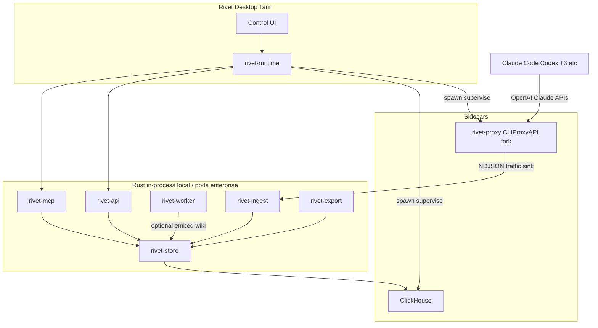

# Rivet architecture

## Goals

1. **Local by default** — one desktop installer (macOS / Linux / Windows), open app, accounts work, harnesses point at `localhost`.
2. **Enterprise-shaped components** — same crates become services behind Helm later.
3. **Fast Rust control plane** — ingest, store, workers, MCP, API in Rust.
4. **Proven proxy** — fork/embed CLIProxyAPI (Go) as a sidecar; do not rewrite providers day one.

## What “tokens” means

**Traffic data:** prompts, completions, tool calls, usage counts, model IDs, latency, cache hits, project/session IDs.

**Not exportable:** OAuth blobs, API keys, management secrets, provider credentials.

## Component map

## Local vs enterprise

| Concern | Local (desktop) | Enterprise (Helm) |
| --- | --- | --- |
| Proxy | Sidecar process | Deployment |
| ClickHouse | Bundled single-node | Cluster / managed CH |
| Workers | Tokio tasks in-process | Job pods / queue consumers |
| Bus | Polling workers (local) | NATS or Redpanda |
| Auth for UI | Loopback Host + `X-Rivet-Key` | OIDC + admin portal |
| Tenancy | Single user | Org / team namespaces |

Interfaces stay the same: ingest protocol, store schemas, MCP tools, export package format.

## Proxy strategy

Fork CLIProxyAPI into `vendor/cliproxyapi` (binary name `rivet-proxy`).

Add a **Rivet sink**: on each finalized request/response (including streams), append a structured event to a Unix socket or `http://127.0.0.1:<rivet>/v1/ingest` that `rivet-ingest` owns.

Keep upstream login flows (`-claude-login`, `-codex-device-login`, etc.). Desktop UI wraps them.

Routing features Theo cares about (session affinity, soonest-reset-first) live in the fork over time.

## Data plane

**ClickHouse** (bundled sidecar or `RIVET_CLICKHOUSE_URL`) — primary local traffic store for `traffic_events`; the desktop status API reports `traffic_backend: clickhouse`.

**File-backed meta** — app config, wiki page index, job cursors, and quota history samples under `meta/` in the Rivet data directory (via `rivet-store` `MetaStore`).

**Object/blob dir** — large bodies / export packages under the OS data directory
(macOS `~/Library/Application Support/Rivet`, Linux `~/.local/share/Rivet`,
Windows `%APPDATA%\Rivet`; override with `RIVET_DATA_DIR`).

### Core tables (ClickHouse)

- `traffic_events` — one row per request or stream segment (ts, account_id, provider, model, session_id, project_id, role, tokens_in/out, latency_ms, body_ref)
- `usage_rollups` — materialized views by account/model/day
- `embeddings` — optional; vector column or external index pointer
- `wiki_pages` — optional generated docs (markdown under `wiki/` + file meta index)

## Workers

Local: `rivet-worker` Tokio tasks polled on a timer (vectorize + wiki); not a push bus yet.

Enterprise: same crate, pull from NATS/Redpanda.

Jobs:

1. Normalize / redact traffic into searchable documents
2. Embed (if embedding model configured)
3. Wiki upsert per project — markdown tree plus a **README.md** that always
   includes a TOC of every file in that project (optional LLM overview when
   `wiki_model` is set)

MCP works without 2–3 (SQL + full-text). Quality jumps with vectors + wiki.

## Export / import

Package format: `.rivetbag` (tar + gzip)

Contains: `manifest.json` + `traffic_events.json` (embeddings/wiki optional later).

Excludes: OAuth credential directories, proxy access keys, management secrets. Captured content may still hold sensitive text after best-effort redaction.

## Desktop UX (Docker Desktop–like)

- Tray + main window (close-to-tray; Quit from tray stops `rivetd`)
- GUI ↔ host is **Tauri IPC** (`ensure_rivetd` / `api_request`); host ↔ `rivetd` is
  **local socket IPC** (Unix domain socket / Windows named pipe), Docker Desktop–style —
  never TCP/HTTP. The webview never sees `X-Rivet-Key` (host injects auth). Loopback TCP
  remains only for proxy ingest + optional CLI/MCP.
- Status bar: sync spinner + event/session counts (bottom-left), center status text
- Proxy running / stopped
- Accounts: list of signed-in credentials + always-visible **Add account** (provider picker)
- Codex / ChatGPT: browser OAuth by default; **Use device code instead** appears after
  starting Codex login (not in the provider picker)
- Settings: nested sidebar destinations (Accounts / Intelligence / Harness); main views
  stay mounted so switching pages does not remount the whole tree
- Quota: live remaining % + per-window bars; history sampled into `meta/`; tokens/cost from traffic
- Wiki: project README shelf → link-only navigation; FS watcher keeps meta in sync
  (creates/edits/deletes, including removing a project folder) without a Refresh button
- MCP endpoint + copy config for harnesses
- Export / import
- Point harness: per-account one-click overlay into `~/.claude` / `~/.codex`
  (backup first); isolated Rivet config dirs remain as an advanced option

### Inspired by T3 Code (backlog)

Shipped: account list + Add, browser Codex login (device code after start), nested Settings
nav, keep-alive main views, per-account harness install, **pooled window bars**, **Cost /
Tokens / Limits (`C`/`T`/`L`)** on Quota, **limit-hit recovery banners**, **branded
connect/reconnect cards**, **first-run checklist overlay**, **stale “checked Nm ago” stamps**
with ~5m quota refresh + manual Refresh credentials, ClickHouse-only traffic backend in UI.

**Medium**

7. Inline remaining meters on the status bar / Runtime header for the active provider.
8. Command palette / shortcuts for Quota, Traffic, Settings (and period chips).
9. Manual OAuth callback paste when loopback/browser handoff fails.
10. Account detail sheet: plan, email, reset times, cooldown, “Use reset” if credits exist.
11. Empty states with one primary action (already partial; make universal copy pattern).
12. Environment-style filter only if Rivet grows multi-machine hubs; skip for local MVP.

**Skip / don’t copy**

- Thread composer, `/usage-limits` slash commands, mobile widgets, worktree/PR chrome —
  wrong product surface for Rivet (traffic hub, not agent IDE).

## Security / ToS posture

- Capture is local by default
- Export is user-initiated traffic sharing, not credential sharing
- Multi-account pooling carries provider ToS risk (disclose in product); Rivet does not encourage reselling sub traffic as public API

## Stack locks

- Rust for Rivet backend crates
- Go only inside forked proxy sidecar
- Tauri 2 desktop → DMG / deb+AppImage / NSIS
- ClickHouse for analytics events
- No TigerBeetle (wrong problem domain)
- No Flink locally; Rust workers (+ Redpanda later for enterprise fan-out)
