# Rivet architecture

Rivet is a local-first multi-account AI proxy: harnesses talk to a localhost
proxy, Rivet captures traffic into ClickHouse, and the desktop app surfaces
quota, conversation history, wiki, and MCP.

## Goals

1. **Local by default** — one desktop installer; accounts and harnesses work on `localhost`.
2. **Enterprise-shaped components** — same crates can become Helm services later.
3. **Fast Rust control plane** — ingest, store, workers, MCP, and API in Rust.
4. **Proven proxy** — fork/embed CLIProxyAPI (Go) as `rivet-proxy`; do not rewrite providers day one.

## What is (and isn’t) traffic

**Captured / exportable traffic:** prompts, completions, tool calls, usage counts,
model IDs, latency, session/project IDs, account labels.

**Never exported as credentials:** OAuth blobs, API keys, management secrets,
provider credentials under `proxy/auth/`. Captured text may still be sensitive
after best-effort redaction.

---

## System overview

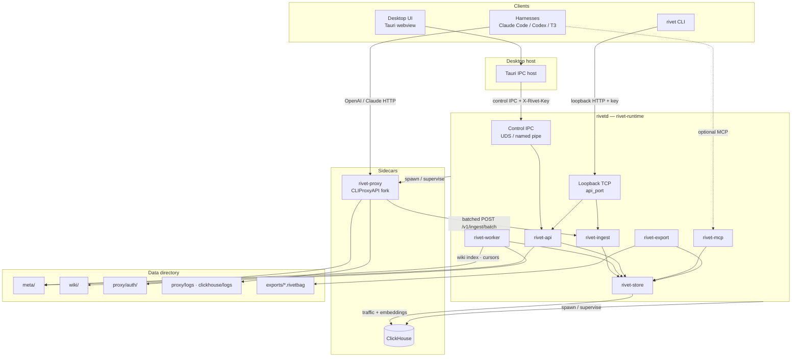

**Process boundaries**

| Process | Owns |
| --- | --- |
| Desktop app | Tray, UI, starts/stops `rivetd` via Tauri |
| `rivetd` | API, ingest, workers, MCP, control IPC; supervises sidecars |
| `rivet-proxy` | Provider routing, OAuth login, quota management API |
| ClickHouse | Durable `traffic_events` |

---

## Ports, URLs, and auth

| Surface | Default | Auth |
| --- | --- | --- |
| Proxy (harnesses) | `http://127.0.0.1:18317` | Harness → proxy access key / provider OAuth as configured |
| API + ingest | `http://127.0.0.1:8741` | Loopback Host + `X-Rivet-Key` / `X-Rivet-Ingest-Key` |
| MCP | `http://127.0.0.1:8742/mcp` | Loopback Host/Origin guards |
| ClickHouse HTTP | `http://127.0.0.1:8123` | Local sidecar / `RIVET_CLICKHOUSE_URL` |
| Control IPC | `{data}/rivetd.sock` (Windows named pipe) | Host injects key; webview never sees it |

Env overrides: `RIVET_DATA_DIR`, `RIVET_CLICKHOUSE_URL`, `RIVET_PROXY_BIN`,
`RIVET_CLICKHOUSE_BIN`. Runtime sets `RIVET_INGEST_URL` / `RIVET_INGEST_KEY` when
spawning the proxy.

---

## Data flows

### 1. Model request path (harness → provider)

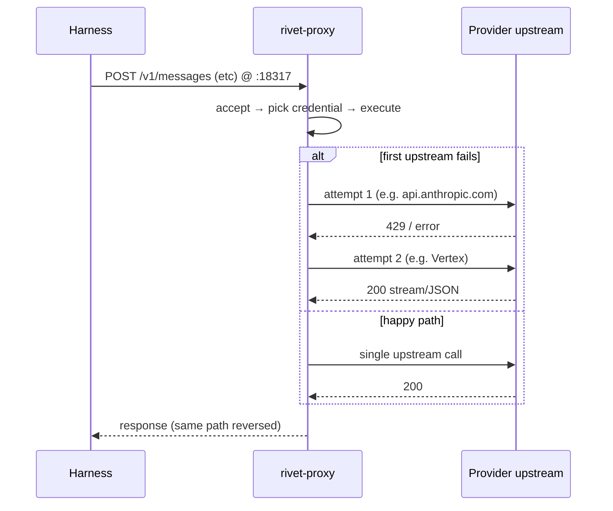

The harness never calls providers directly. Each failover retry is an extra
`proxy → upstream` hop.

### 2. Traffic capture (proxy → ClickHouse)

Not disk log scraping. The Rivet fork wraps CPA’s request logger and **pushes**
events over HTTP.

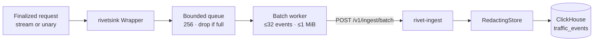

| Detail | Behavior |
| --- | --- |
| Trigger | Same logger hook CPA uses for request logs |
| Payload | Structured `TrafficEvent` (no credentials) |
| Disk `request-log` | **Off by default** — ClickHouse is the product store |
| Forced errors | `error-*.log` still written when the inner logger is disabled |
| Process logs | Under `logs-max-total-size-mb: 256` cleaner |

### 3. Desktop control path (UI → rivetd)

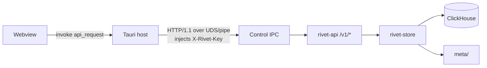

Loopback TCP on `api_port` still serves the same control routes for CLI, plus
ingest for the proxy. The webview never uses TCP to `rivetd` and never sees the
raw access key.

### 4. Conversations / Data pane

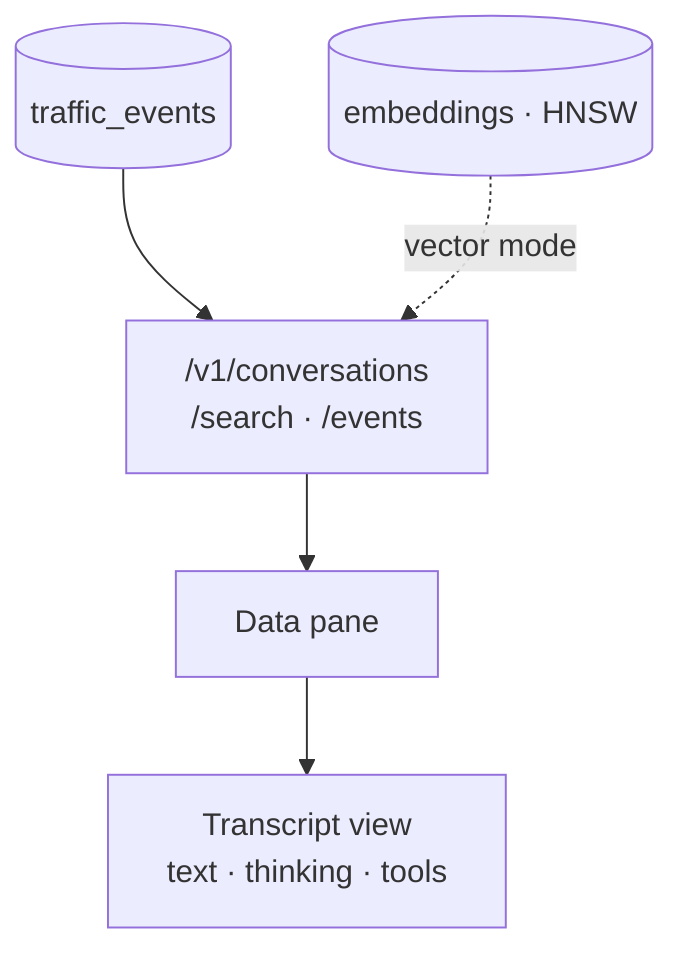

Events sharing a `session_id` become one conversation. Keyword search hits
ClickHouse content; vector search uses the ClickHouse HNSW `embeddings` index
then hydrates traffic rows.

### 5. Quota

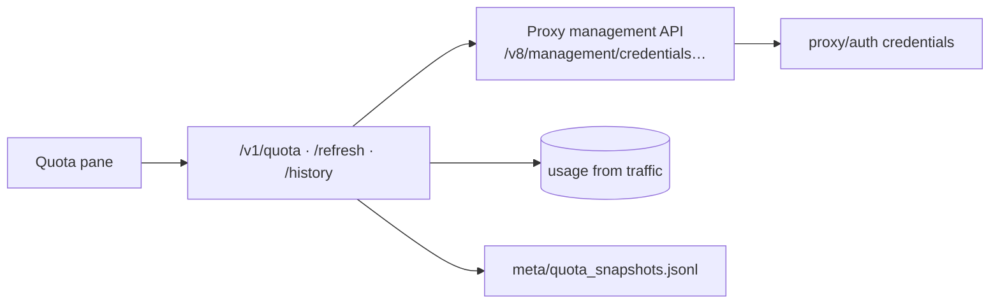

Management calls use `management_secret` (not the harness access key). History
samples live in meta JSONL, not ClickHouse.

### 6. Accounts / OAuth

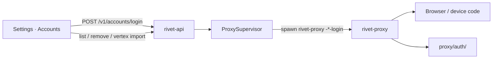

### 7. Harness install

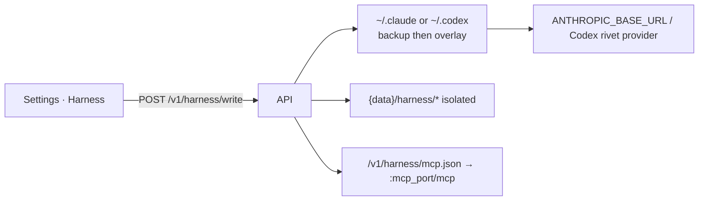

### 8. Workers: wiki + embeddings

```mermaid
flowchart TB
  Tick[Worker tick ~20s] --> CH[(ClickHouse traffic)]
  CH --> WikiJob[Wiki upsert]
  CH --> VecJob[Vectorize]
  WikiJob --> WikiFS[wiki/&#123;project&#125;/*.md]
  WikiJob --> MetaW[meta/wiki_pages.json]
  VecJob --> Emb[(ClickHouse embeddings<br/>64-dim · HNSW)]
  FS[FS watcher] --> MetaW
```

MCP and Data search work with keyword SQL alone; vectors and wiki improve
quality when enabled. Legacy `meta/embeddings.json` is imported once into
ClickHouse on boot, then renamed `.migrated`.

### 9. MCP

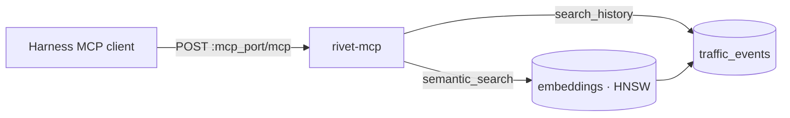

### 10. Export / import

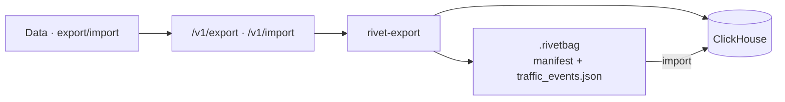

Embeddings and wiki are not packaged yet. Credentials are never included.

### 11. Logs (debug escape hatch)

```mermaid
flowchart LR
  UI[Runtime pane] --> API["/v1/logs/&#123;proxy|clickhouse&#125;"]
  API --> Files[Newest *.log under<br/>proxy/logs or clickhouse/logs]
```

### 12. Sidecar lifecycle

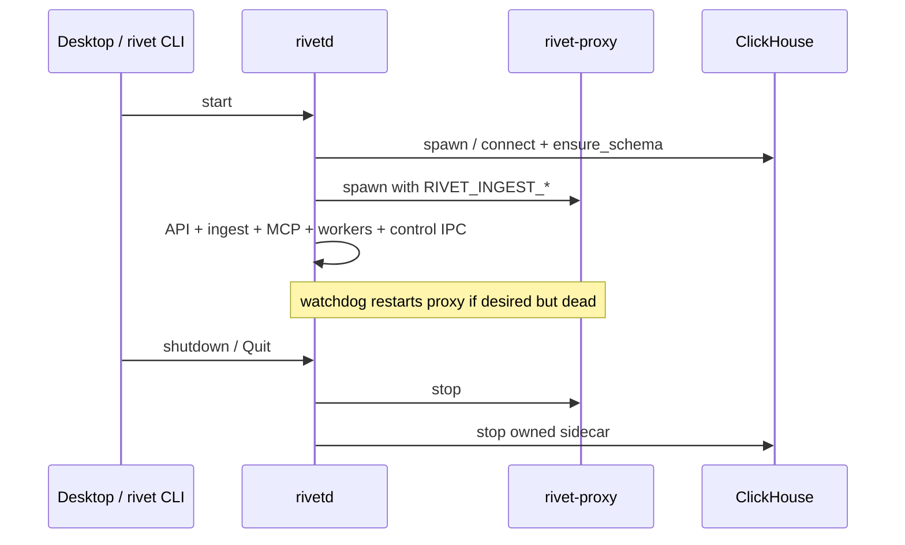

---

## Storage model

### ClickHouse

Primary local store. Schema applied at boot (`CREATE DATABASE rivet` + tables).

| Table / artifact | Role |
| --- | --- |
| `traffic_events` | One row per captured request/stream segment |
| `embeddings` | Lexical (64-dim) vectors with HNSW `vector_similarity('hnsw', 'cosineDistance', 64)` |

`usage_rollups` and `wiki_pages` as CH tables remain sketched / optional; the
wiki **index** and quota history samples still live in meta files.

### Meta files (`{data}/meta/`)

| File | Role |
| --- | --- |
| Job cursors | Vectorize / wiki progress |
| `wiki_pages.json` | Wiki page index for the UI |
| `quota_snapshots.jsonl` | Quota history samples |
| `embeddings.json` | Legacy only — imported into CH once, then `.migrated` |

### Other directories

| Path | Role |
| --- | --- |
| `proxy/auth/` | OAuth / provider credentials (never exported) |
| `proxy/logs/` | Process + forced error logs |
| `wiki/` | Generated markdown tree |
| `exports/` | `.rivetbag` packages |
| `blobs/` | Reserved for spilled bodies (`body_ref`); content usually inline in CH today |
| `pids/` | Sidecar PID tracking |

Default data root: macOS
`~/Library/Application Support/Rivet`, Linux `~/.local/share/Rivet`, Windows
`%APPDATA%\Rivet` (`RIVET_DATA_DIR` overrides).

---

## Local vs enterprise

| Concern | Local (desktop / CLI) | Enterprise (Helm) |
| --- | --- | --- |
| Proxy | Sidecar process (`:18317`) | Deployment (chart often `:8317`) |
| ClickHouse | Bundled single-node or URL | Cluster / managed |
| Workers | In-process Tokio poll | Job pods / queue consumers |
| Bus | Polling | NATS or Redpanda later |
| UI auth | Loopback + key / control IPC | OIDC + admin portal |
| Tenancy | Single user | Org / team namespaces |

Shared contracts: ingest protocol, store schemas, MCP tools, `.rivetbag` format.

---

## Desktop UX map

| Pane | Reads | Writes |
| --- | --- | --- |
| Quota | `/v1/quota`, history, traffic burn | Refresh credentials |
| Data | Conversations / search / events | Export · import |
| Runtime | Status, sidecar health, log tails | Start/stop proxy |
| Wiki | `/v1/wiki` + pages | (generated by worker) |
| Settings | Accounts, intelligence, harness | Login, import, harness write |

Close-to-tray; Quit from tray stops `rivetd`.

---

## Security / ToS posture

- Capture is local by default.
- Export is user-initiated traffic sharing, not credential sharing.
- Multi-account pooling carries provider ToS risk (disclose in product).

## Stack locks

- Rust for Rivet backend crates
- Go only inside the forked proxy sidecar
- Tauri 2 desktop → DMG / deb+AppImage / NSIS
- ClickHouse for traffic analytics events
- No TigerBeetle; no Flink locally (Rust workers; Redpanda later for enterprise fan-out)

## Implementation notes (doc vs code)

1. **Ingest** is HTTP batch to `/v1/ingest/batch`, not Unix-socket NDJSON (`ingest.sock` path may exist unused).
2. **Embeddings** live in ClickHouse with HNSW; **wiki index** and **quota history** remain meta-file backed.
3. **`body_ref` / `blobs/`** are reserved; most bodies live in the `content` column.
4. Helm proxy port may differ from the local default `18317`.
